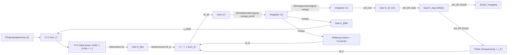

# Praktikum PRTA – Versuch V2: Modellbildung Drosselklappe
**Prof. Dr. Brüdigam | OTH Regensburg**
**Vorbereitungsausarbeitung, Fragenbeantwortung und MATLAB/Simulink Verifikation**

---

## 1. Beantwortung der physikalischen Grundlagenfragen (Kapitel 1.4)

### 1.1 Wie ergibt sich aus der Eingangsspannung der Motorstrom?
Der elektrische Teil des permanenterregten Gleichstrommotors (GS-Motor) wird durch die Maschengleichung des Ankerstromkreises beschrieben:
$$u(t) = R_A \cdot i(t) + L_A \cdot \frac{di(t)}{dt} + u_{\mathrm{EMK}}(t)$$

Umgestellt nach dem induktiven Spannungsabfall:
$$u(t) - u_{\mathrm{EMK}}(t) = R_A \cdot i(t) + L_A \cdot \frac{di(t)}{dt}$$

Im Laplace-Bereich mit der elektrischen Zeitkonstante $T_{\mathrm{el}} = \frac{L_A}{R_A}$:
$$U(s) - U_{\mathrm{EMK}}(s) = (R_A + s L_A) \cdot I(s) = R_A (1 + s\, T_{\mathrm{el}}) \cdot I(s)$$
$$I(s) = \frac{\frac{1}{R_A}}{\frac{L_A}{R_A} s + 1} \cdot \left( U(s) - U_{\mathrm{EMK}}(s) \right)$$

> [!NOTE]
> Der Motorstrom $i(t)$ ergibt sich als Ausgang eines **$PT_1$-Gliedes** mit der Verstärkung $K_{\mathrm{el}} = \frac{1}{R_A}$ und der Zeitkonstante $T_{\mathrm{el}} = \frac{L_A}{R_A}$, angeregt durch die effektive Spannung $u_{\mathrm{eff}}(t) = u(t) - u_{\mathrm{EMK}}(t)$. Da in der Praxis $\tau_{\mathrm{mech}} \gg \tau_{\mathrm{el}}$ gilt, wird $T_{\mathrm{el}}$ im Blockschaltbild des Professors häufig vereinfacht vernachlässigt ($I \approx \frac{1}{R_A} (u - u_{\mathrm{EMK}})$). Im erstellten Simulink-Modell ist die exakte Übertragungsfunktion implementiert.

---

### 1.2 Wie ergibt sich aus dem Motorstrom das Motormoment?
Das erzeugte elektromagnetische Drehmoment $M_{\mathrm{el}}$ (bzw. $M_{\mathrm{Mot}}$) entsteht durch die Lorentzkraft auf die stromdurchflossenen Leiter im Magnetfeld der Permanentmagnete:
$$M_{\mathrm{el}}(t) = k_{\mathrm{Mot}} \cdot i(t) = c \cdot \Phi_E \cdot i(t)$$
- $k_{\mathrm{Mot}}$: Drehmomentkonstante des Motors in $[\mathrm{N\cdot m / A}]$.
- $c \cdot \Phi_E$: Maschinenkonstante multipliziert mit dem Erregerfluss.

---

### 1.3 Wie ergibt sich das effektive Motormoment?
An der Motorwelle gilt das Momentengleichgewicht:
$$M_{\mathrm{eff}}(t) = M_{\mathrm{el}}(t) - M_R(t) - M_{F,\mathrm{mot}}(t)$$
- $M_{\mathrm{eff}}$: das resultierende beschleunigende Drehmoment.
- $M_R$: das mechanische Reibmoment (Lager, Bürsten, Getriebe).
- $M_{F,\mathrm{mot}}$: das über die Getriebeübersetzung auf die Motorwelle reduzierte Rückstellmoment der Notlauffeder.

---

### 1.4 Wie ergibt sich die Winkelbeschleunigung des Motors?
Nach dem Grundgesetz der Drehbewegung (Newton II für Rotation) gilt:
$$J_{\mathrm{ges}} \cdot \dot{\omega}(t) = M_{\mathrm{eff}}(t) \implies \dot{\omega}(t) = \frac{1}{J_{\mathrm{ges}}} \cdot M_{\mathrm{eff}}(t)$$
- $J_{\mathrm{ges}}$: das auf die Motorwelle reduzierte Gesamtmassenträgheitsmoment (Rotor, Zahnräder und Drosselklappe).

---

### 1.5 Wie ergibt sich die Drehzahl des Motors?
Die Motordrehzahl $\omega(t)$ bzw. $n(t)$ ergibt sich durch zeitliche Integration der Winkelbeschleunigung $\dot{\omega}(t)$:
$$\omega(t) = \int_0^t \dot{\omega}(\tau) \, d\tau + \omega(0) \quad \text{bzw. im Laplace-Bereich: } \Omega(s) = \frac{1}{s} \cdot \dot{\Omega}(s)$$
Umrechnung in die Drehzahl $n$ in Umdrehungen pro Minute:
$$n(t) = \frac{60}{2\pi} \cdot \omega(t)$$

---

### 1.6 Wie ergibt sich die Winkelposition des Motors?
Die Winkelposition des Rotors $\phi_{\mathrm{mot}}(t)$ ergibt sich durch nochmalige Integration der Winkelgeschwindigkeit $\omega(t)$:
$$\phi_{\mathrm{mot}}(t) = \int_0^t \omega(\tau) \, d\tau + \phi_{\mathrm{mot}}(0) \quad \text{bzw. } \Phi_{\mathrm{mot}}(s) = \frac{1}{s} \cdot \Omega(s)$$

---

### 1.7 Wie ergibt sich die Winkelposition der Klappe?
Über das Untersetzungsgetriebe mit dem Übersetzungsverhältnis $i = \frac{n_{\mathrm{mot}}}{n_{\mathrm{DK}}} > 1$ (bzw. dem Getriebefaktor $K_{\mathrm{Gr}} = \frac{1}{i}$):
$$\phi_{\mathrm{DK,rad}}(t) = K_{\mathrm{Gr}} \cdot \phi_{\mathrm{mot}}(t) = \frac{1}{i} \cdot \phi_{\mathrm{mot}}(t)$$
Umrechnung in Winkelgrad ($^\circ$):
$$\phi_{\mathrm{DK,deg}}(t) = K_{\mathrm{deg}} \cdot \phi_{\mathrm{DK,rad}}(t) = \frac{180^\circ}{\pi} \cdot \phi_{\mathrm{DK,rad}}(t)$$

---

### 1.8 Wie ergibt sich die EMK und welchen Einfluss hat sie?
- **Entstehung:** Nach dem Induktionsgesetz induziert die Drehung der Ankerleiter im Permanentmagnetfeld eine Gegen-EMK (elektromotorische Kraft), die streng proportional zur Motordrehzahl ist:
  $$u_{\mathrm{EMK}}(t) = k_{\mathrm{EMK}} \cdot \omega(t) = c \cdot \Phi_E \cdot \omega(t)$$
  Im SI-Einheitensystem sind $k_{\mathrm{EMK}}$ (in $\mathrm{V\cdot s / rad}$) und $k_{\mathrm{Mot}}$ (in $\mathrm{N\cdot m / A}$) zahlenmäßig identisch.
- **Einfluss:** Die EMK wirkt an der elektrischen Summierstelle subtraktiv auf die von außen angelegte Motorspannung:
  $$u_{\mathrm{eff}}(t) = u(t) - u_{\mathrm{EMK}}(t)$$
  Mit steigender Drehzahl $\omega$ steigt $u_{\mathrm{EMK}}$, wodurch der Strom $i(t)$ und damit das Beschleunigungsmoment sinken. Dies stellt eine **stabile innere Geschwindigkeits-Gegenkopplung** dar, die das System dämpft und im Leerlauf die maximale Motordrehzahl begrenzt ($u_{\mathrm{EMK}} \to u$).

---

### 1.9 Woraus resultieren und wie wirken Reib- und Federmoment?

#### Reibmoment $M_R$:
- **Ursache:** Mechanische Reibung in den Wälz-/Gleitlagern des Motors, Reibung der Kohlebürsten auf dem Kommutator, Zahnflankenreibung des Getriebes und Reibung der Klappenwellendichtung/Lager.
- **Wirkung:** Das Reibmoment wirkt stets der Bewegungsrichtung entgegen ($\operatorname{sign}(\omega)$). Es setzt sich zusammen aus:
  1. *Coulomb-Gleitreibung und Losbrechmoment (Haftreibung)*: $M_C \cdot \operatorname{sign}(\omega)$
  2. *Viskose Dämpfung*: $d \cdot \omega$ (proportional zur Geschwindigkeit)

#### Federmoment $M_F$ (Notlauffeder):
- **Ursache:** Sicherheitsfeder (Limp-Home-Mechanismus). Fällt die elektrische Bestromung komplett aus, muss die Drosselklappe zuverlässig in eine Notlaufposition $\phi_0$ (ca. $5^\circ \dots 10^\circ$) gezogen werden, damit der Verbrennungsmotor im Notlauf weiterläuft und nicht erstickt.
- **Besonderheit (Momentensprung):** Die Feder ist mechanisch beidseitig vorgespannt. Dadurch entsteht an der Notlaufstellung $\phi_0$ ein **ausgeprägter Momentensprung** (wesentliche System-Nichtlinearität):
  - Für $\phi > \phi_0$ (Klappe öffnet) zieht die Rückholfeder mit Grundvorspannung $M_{F0}$ plus linearer Steifigkeit $c_F (\phi - \phi_0)$ in Schließrichtung.
  - Für $\phi < \phi_0$ (Klappe schließt Richtung $0^\circ$) drückt eine Gegenfeder mit Vorspannung $-M_{F0}$ in Öffnungsrichtung.
  - Im unbestromten Ruhezustand hält der Anschlag die Klappe formschlüssig exakt in $\phi_0$.

---

## 2. Parameterbestimmung im Versuchslabor

Zur Bestimmung der einzelnen Modellblöcke vor Ort stehen folgende Messgeräte zur Verfügung:

| Gerät | Zu bestimmende Parameter | Vorgehensweise / Messmethode |
| :--- | :--- | :--- |
| **Multimeter** | Kaltwiderstand $R_A$, Potentiometer-Kennlinie | 1. Ankerwiderstand $R_A$ mit Ohmmeter messen (Rotor dabei manuell schrittweise drehen, um Bürstenübergangswiderstände zu mitteln). 2. Istwert-Potentiometer: Widerstand bzw. Spannungsteilerverhältnis in Abhängigkeit vom Drehwinkel messen $\to K_{\mathrm{Poti}}$ in $[\mathrm{V/^\circ}]$. |
| **Lineal** | Hebelarm $r$ | Abmessen des Abstands Drehachse bis zum Kraftangriffspunkt an der Klappe/Zahnsegment, um aus Kraftmessungen Drehmomente zu bestimmen ($M = F \cdot r$). |
| **Federwaage / Kraftmesser** | Federkennlinie $c_F$, Vorspannung $M_{F0}$, Haftreibung $M_H$ | Klappe an definiertem Hebelarm mit der Federwaage vorsichtig auslenken: 1. Kraft $F$ bei verschiedenen Winkeln $\phi$ notieren $\to M_F(\phi) = F \cdot r$. Steigung ergibt $c_F$. 2. Kraftsprung an der Notlaufposition $\phi_0$ messen $\to M_{F0}$. 3. Losbrechkraft in beiden Richtungen messen $\to$ Haftreibung $M_H$. |
| **Formelsammlung** | Geometrische Trägheitsmomente $J$, Umrechnungsfaktoren | Trägheitsmomente des Rotors (Zylindermodell $J = \frac{1}{2} m r^2$), Klappenscheibe ($J_{\mathrm{DK}}$), Getriebestufenreduktion ($J_{\mathrm{red}} = J_{\mathrm{mot}} + \frac{1}{i^2} J_{\mathrm{DK}}$). |
| **2-Kanal-Oszilloskop** | $T_{\mathrm{el}}$, $k_{\mathrm{EMK}}$, mechanische Zeitkonstante | 1. Transienter Stromanstieg $i(t)$ bei blockiertem Rotor $\to T_{\mathrm{el}} = \frac{L_A}{R_A}$. 2. Generatorischer Auslauf / Schnappvorgang: Messung von induzierter Spannung $u_{\mathrm{EMK}}(t)$ und Klappensignal $\phi(t)$ $\to k_{\mathrm{EMK}} = \frac{u_{\mathrm{EMK}}}{\omega}$. 3. Sprungantwort des Gesamtsystems auf $6\,\mathrm{V}$ aufzeichnen. |
| **RLC-Meter** | Ankerinduktivität $L_A$, $R_A$ | Direkte Vierleiter-Messung von Induktivität $L_A$ bei Testfrequenz (z.B. $1\,\mathrm{kHz}$). Rotor leicht verdrehen, um Mittelwert über die Kommutatorlamellen zu bilden. |
| **Netzteil (0–30V, 2.5A)** | $k_{\mathrm{Mot}}$, Reibung $M_R$, Sprungantwort | Vorsicht: **Maximal 6 V!** Gleichspannung anlegen und stationären Strom $I_{\mathrm{stat}}$ sowie Drehmoment/Auslenkwinkel erfassen. Bei blockierter Klappe: $M_{\mathrm{el}} = k_{\mathrm{Mot}} \cdot I_{\mathrm{stat}}$. |

---

## 3. Versuchsauswertung (Kapitel 3)

### 3.1 Bestimmung des Faktors für die EMK auf zwei unterschiedliche Weisen

#### Methode 1: Generatorischer Schnappvorgang (Auslauf ohne Bestromung)
Wird die Drosselklappe von Hand (oder durch einen Spannungspuls) ausgelenkt und dann der Motor stromlos geschaltet ($i = 0$), schnappt die Klappe durch die Federkraft beschleunigt in Richtung Notlaufposition zurück.
Da die Motorklemmen offen sind ($i = 0$), entfällt jeder ohmsche Spannungsabfall ($R_A \cdot i = 0$), und die gemessene Klemmenspannung entspricht exakt der Gegen-EMK:
$$u_{\mathrm{Klemme}}(t) = u_{\mathrm{EMK}}(t) = k_{\mathrm{EMK}} \cdot \omega_{\mathrm{mot}}(t)$$
Aus dem zweiten Kanal des Oszilloskops wird das Potentiometersignal $\phi_{\mathrm{DK}}(t)$ erfasst. Die Winkelgeschwindigkeit der Motorwelle ergibt sich über die zeitliche Ableitung und die Getriebeübersetzung:
$$\omega_{\mathrm{mot}}(t) = i \cdot \frac{d\phi_{\mathrm{DK}}(t)}{dt}$$
Der EMK-Faktor ergibt sich zu jedem Zeitpunkt (oder im Nulldurchgang der Maximalgeschwindigkeit) aus dem Quotienten:
$$k_{\mathrm{EMK}} = \frac{u_{\mathrm{EMK}}(t)}{\omega_{\mathrm{mot}}(t)} = \frac{u_{\mathrm{EMK}}(t)}{i \cdot \frac{d\phi_{\mathrm{DK}}}{dt}}$$

#### Methode 2: Stationärer Zustand bzw. elektromechanische Drehmomentgleichheit
Aus den elektrodynamischen Grundgesetzen gilt für einen permanenterregten Gleichstrommotor im SI-Einheitensystem:
$$k_{\mathrm{EMK}} \left[\frac{\mathrm{V\cdot s}}{\mathrm{rad}}\right] = k_{\mathrm{Mot}} \left[\frac{\mathrm{N\cdot m}}{\mathrm{A}}\right]$$
Im motorischen Betrieb bei konstanter Drehzahl gilt:
$$u = R_A \cdot I_{\mathrm{stat}} + k_{\mathrm{EMK}} \cdot \omega_{\mathrm{stat}} \implies k_{\mathrm{EMK}} = \frac{u - R_A \cdot I_{\mathrm{stat}}}{\omega_{\mathrm{stat}}}$$
Alternativ über das gemessene Drehmoment bei bekanntem Strom:
$$k_{\mathrm{EMK}} = k_{\mathrm{Mot}} = \frac{M_{\mathrm{el}}}{I}$$

---

### 3.2 Plausibilisierung ohne Simulation (Stationäres Gleichgewicht)
Ein physikalisches System muss im stationären Endzustand das Kräfte- und Momentengleichgewicht erfüllen:
$$\dot{\omega} = 0, \quad \omega = 0 \implies \text{keine Trägheitskräfte, keine dynamische Reibung, keine Gegen-EMK } (u_{\mathrm{EMK}} = 0)$$

An der stationären Endlage $\phi_{\mathrm{stat}}$ gilt:
1. **Elektrisch:** Der Strom ist rein durch den ohmschen Widerstand bestimmt:
   $$I_{\mathrm{stat}} = \frac{U}{R_A} \quad (\text{bei } U = 6\,\mathrm{V}, R_A = 10\,\Omega \implies I_{\mathrm{stat}} = 0{,}6\,\mathrm{A})$$
2. **Elektromagnetisches Drehmoment:**
   $$M_{\mathrm{el}} = k_{\mathrm{Mot}} \cdot I_{\mathrm{stat}} = k_{\mathrm{Mot}} \cdot \frac{U}{R_A}$$
3. **Mechanisches Momentengleichgewicht:**
   $$M_{\mathrm{el}} = M_{F,\mathrm{mot}}(\phi_{\mathrm{stat}}) + M_{R,\mathrm{stat}}$$
   bzw. an der Drosselklappe:
   $$i \cdot k_{\mathrm{Mot}} \cdot I_{\mathrm{stat}} = M_{F,\mathrm{DK}}(\phi_{\mathrm{stat}}) \pm M_{R,\mathrm{Haft}}$$

> [!TIP]
> **Plausibilitätsprüfung:**
> Man nimmt die unabhängig mit der Federwaage bestimmte Federkennlinie $M_{F,\mathrm{DK}}(\phi_{\mathrm{stat}})$, addiert das Reibmoment und vergleicht diesen Wert mit dem Produkt aus Motorstrom, Drehmomentkonstante und Getriebeübersetzung ($i \cdot k_{\mathrm{Mot}} \cdot I$). Stimmen beide Seiten innerhalb der Messgenauigkeit überein, sind die Kennlinien und Konstanten gegenseitig plausibilisiert!

---

## 4. Testfragen (Kapitel 4)

### 4.1 Blockschaltbild der Drosselklappe und Erklärung der Blöcke

#### Erklärung der einzelnen Blöcke:
1. **Sum_U ($+ -$)**: Bildet die wirksame Ankerspannung $u_{\mathrm{eff}} = u - u_{\mathrm{EMK}}$.
2. **PT1-Glied Anker**: Modelliert den Ankerkreis mit ohmschem Widerstand $R_A$ und Induktivität $L_A$. Übertragungsfunktion $\frac{1/R_A}{T_{\mathrm{el}}s + 1}$. Ausgang ist der Strom $i(t)$.
3. **Gain $k_{\mathrm{Mot}}$**: Wandelt den Strom proportional in das elektromagnetische Antriebsmoment $M_{\mathrm{el}} = k_{\mathrm{Mot}} \cdot i$ um.
4. **Sum_M ($+ - -$ )**: Berechnet das effektive Beschleunigungsmoment: $M_{\mathrm{eff}} = M_{\mathrm{el}} - M_R - M_F$.
5. **Gain $1/J$**: Beschleunigung nach Newton II: $\dot{\omega} = \frac{M_{\mathrm{eff}}}{J_{\mathrm{ges}}}$.
6. **Integrator 1 ($1/s$)**: Integriert $\dot{\omega}$ zur Winkelgeschwindigkeit $\omega$.
7. **Integrator 2 ($1/s$)**: Integriert $\omega$ zur Winkelposition $\phi_{\mathrm{mot}}$.
8. **Gain $k_{\mathrm{EMK}}$**: Berechnet die Gegen-EMK $u_{\mathrm{EMK}} = k_{\mathrm{EMK}} \cdot \omega$ zur Spannungsrückführung.
9. **Reibungsblock**: Berechnet das Reibmoment $M_R(\omega)$ aus viskoser Dämpfung und Coulomb-Gleitreibung.
10. **Gain $K_{\mathrm{Gr}} = 1/i$**: Getriebeuntersetzung von Motor- auf Klappenwinkel.
11. **Gain $K_{\mathrm{deg}} = \frac{180}{\pi}$**: Umrechnung von Bogenmaß $[\mathrm{rad}]$ in Grad $[^\circ]$.
12. **Federmodell**: Erzeugt das rückstellende Drehmoment $M_F(\phi)$ inklusive des Vorspannungssprungs an der Notlaufstellung $\phi_0$.

---

### 4.2 Mindestens zwei Möglichkeiten zur Bestimmung der Induktivität einer Spule

#### Möglichkeit 1: Messung der Übergangszeitkonstante bei DC-Sprungantwort (Zeitbereich)
- Die Spule mit Innenwiderstand $R$ wird über einen Vorwiderstand oder direkt an eine Gleichspannungsquelle geschaltet.
- Der Stromverlauf $i(t) = I_{\mathrm{end}} \cdot \left(1 - e^{-t/T_{\mathrm{el}}}\right)$ wird am Oszilloskop aufgezeichnet.
- Die Zeitkonstante $T_{\mathrm{el}}$ ist die Zeit, bei der der Strom $63{,}2\%$ des stationären Endwertes erreicht:
  $$L = R \cdot T_{\mathrm{el}}$$

#### Möglichkeit 2: Wechselstrom-Scheinwiderstandsmessung (Frequenzbereich)
- Die Spule wird an eine Wechselspannungsquelle mit bekannter Frequenz $f$ (z.B. $50\,\mathrm{Hz}$ oder $1\,\mathrm{kHz}$) und Effektivspannung $U_{\mathrm{eff}}$ angeschlossen.
- Mit einem Multimeter/Amperemeter werden Effektivspannung $U$ und Strom $I$ gemessen.
- Der Scheinwiderstand ist $Z = \frac{U}{I} = \sqrt{R^2 + (\omega L)^2} = \sqrt{R^2 + (2\pi f L)^2}$.
- Nach der Induktivität $L$ aufgelöst:
  $$L = \frac{\sqrt{Z^2 - R^2}}{2\pi f} = \frac{\sqrt{\left(\frac{U}{I}\right)^2 - R^2}}{2\pi f}$$

#### Möglichkeit 3 (Zusatz): Resonanzmethode (LC-Schwingkreis)
- Spule parallel zu einem Präzisionskondensator $C_{\mathrm{bekannt}}$ schalten.
- Resonanzfrequenz $f_0$ mit Funktionsgenerator und Oszilloskop bestimmen.
- Nach Thomson'scher Schwingungsgleichung: $f_0 = \frac{1}{2\pi \sqrt{L C}} \implies L = \frac{1}{(2\pi f_0)^2 \cdot C}$.

---

### 4.3 Analyse des Testfragen-Systems $F(s) = \frac{5}{2 s^2 + 8}$

Gegeben ist die Übertragungsfunktion:
$$F(s) = \frac{5}{2s^2 + 8} = \frac{2{,}5}{s^2 + 4}$$

1. **Polstellen und Stabilität:**
   - Nennernullstellen: $s^2 + 4 = 0 \implies s_{1,2} = \pm j 2$.
   - Es liegen rein imaginäre Pole ohne Realteil vor. Das System ist ein **ungedämpfter harmonischer Oszillator** (Grenzstabilität).
   - Eigenkreisfrequenz: $\omega_0 = 2\,\mathrm{rad/s}$
   - Schwingungsdauer: $T_0 = \frac{2\pi}{\omega_0} = \pi \approx 3{,}1416\,\mathrm{s}$
   - Frequenz: $f_0 = \frac{1}{\pi} \approx 0{,}3183\,\mathrm{Hz}$
2. **Statische Verstärkung:**
   $$K = F(0) = \frac{5}{8} = 0{,}625$$
3. **Sprungantwort auf Sprung von $0$ auf $5$:**
   $$Y(s) = F(s) \cdot \frac{5}{s} = \frac{12{,}5}{s(s^2 + 4)}$$
   Rücktransformation in den Zeitbereich:
   $$y(t) = 3{,}125 \cdot (1 - \cos(2t)) \cdot \sigma(t)$$
   - Minimum: $y_{\mathrm{min}} = 0$
   - Maximum: $y_{\mathrm{max}} = 2 \cdot 3{,}125 = 6{,}25$
   - Schwingungsmittelwert: $\bar{y} = 3{,}125$

---

## 5. Simulink-Modelle und Simulationsverifikation

Die folgenden Simulink-Modelle und MATLAB-Skripte wurden im Arbeitsverzeichnis erstellt und erfolgreich getestet:

- [EI7_V2.slx](file:///c:/Users/johan/Lokal/RTA/RTA/V2_Modellbildung/EI7_V2.slx): Hauptmodell der Drosselklappe (native Version)
- [EI7_V2_R2018b.slx](file:///c:/Users/johan/Lokal/RTA/RTA/V2_Modellbildung/EI7_V2_R2018b.slx): **Praktikumstaugliche R2018b-Version**
- [testfrage_system.slx](file:///c:/Users/johan/Lokal/RTA/RTA/V2_Modellbildung/testfrage_system.slx): Modell für $F(s) = \frac{5}{2s^2+8}$
- [testfrage_system_R2018b.slx](file:///c:/Users/johan/Lokal/RTA/RTA/V2_Modellbildung/testfrage_system_R2018b.slx): R2018b-Version des Testfragen-Modells
- [init_parameters.m](file:///c:/Users/johan/Lokal/RTA/RTA/V2_Modellbildung/init_parameters.m): Vollständige Parameterdefinition
- [build_models.m](file:///c:/Users/johan/Lokal/RTA/RTA/V2_Modellbildung/build_models.m): Programmatischer Generator für alle Simulink-Modelle
- [simulate_and_verify.m](file:///c:/Users/johan/Lokal/RTA/RTA/V2_Modellbildung/simulate_and_verify.m): Automatisierte Simulation und Validierung

### 5.1 Simulationsergebnisse: Drosselklappe (EI7_V2)

- **Ruhezustand vor Sprung:** Klappe steht exakt auf Notlaufposition $\phi_0 = 7^\circ$.
- **Sprung $0 \to 6\,\mathrm{V}$ bei $t = 0{,}5\,\mathrm{s}$:**
  - Der Motor überwindet die Vorspannung der Notlauffeder.
  - Der Klappenwinkel schwingt sanft gedämpft ein und erreicht bei $t \approx 2\,\mathrm{s}$ den stationären Öffnungswinkel von $\approx 22{,}3^\circ$.
  - Der Einschalt- und Haltestrom stabilisiert sich bei $I = \frac{U}{R_A} = 0{,}6\,\mathrm{A}$, die Drehzahl kehrt auf $0$ zurück.

### 5.2 Simulationsergebnisse: Testfrage $F(s)$

- Der Sprung $0 \to 5$ bei $t = 1\,\mathrm{s}$ regt das System zu einer ungedämpften Sinusschwingung zwischen $0{,}0$ und $6{,}25$ mit Periode $T = \pi \approx 3{,}14\,\mathrm{s}$ an.
- Der Schwingungsmittelwert liegt exakt auf dem theoretischen Wert von $3{,}125$.
